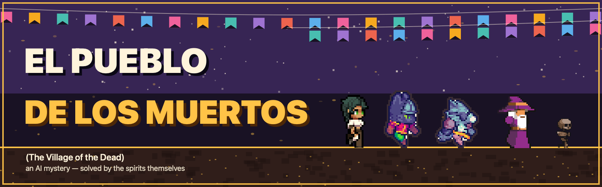

<p align="center">
  
</p>

# El Pueblo de los Muertos 🕯️

**Nine AI spirits. One stolen portrait. No scripts — they solve it themselves.**

- **Every spirit is a real AI agent** — each one runs on a small open-weight
  language model, on-device. They decide where to walk, who to talk to, what
  to say, and what to share.
- **The spirits solve it by talking** — they trade secrets, overhear each
  other, repeat lies, and carry evidence mouth-to-mouth until three proofs
  reach the right ears and someone marches on the thief.
- **AI controls the voices — the game keeps the facts** — the model proposes
  everything they say and do; a deterministic engine owns what is true: who
  knows what, the proof count, the verdict.
- **The stakes are real** — the portrait was the last thing keeping Solorio
  remembered. Solve it before the town forgets him twice.

**No player needed — the AI spirits solve the case on their own.** But you
can join in: tap a spirit and ask what it knows, carry a whisper to someone
else, send them to ask each other, or speak a fading name to bring a ghost
back.

*Inspired by the emotional world of Pixar's
[*Coco*](https://movies.disney.com/coco) and the real tradition of
Día de los Muertos — an original story, characters, and art.*

<p align="center">
  <a href="https://movies.disney.com/coco">
    
  </a><br>
  <sub><i>Coco</i> (2017) poster — © Disney/Pixar, shown here as the film that
  inspired this game's themes. All in-game art is original.</sub>
</p>

No API keys, no cloud — the whole village thinks offline.

## How the mystery plays out

- **The intro** — Ramón himself, in full color, lifts the veiled portrait
  from a wall of framed dead; two villagers find the bare slot moments later
  and never look his way.
- **The hunt** — spirits inspect the ofrenda, find the dropped guitar pick,
  hear whispers, trade secrets in conversation, and watch private mutters
  leak into the open.
- **The fade** — a spirit whose remembrance battery dies dims into a
  translucent skeleton until someone speaks their name. Solorio is the
  victim *and* the witness — his testimony fades with him. Spread his name
  and the town can still bring him back.
- **The confession** — at three established proofs the ledger fills and a
  🕯 accuser marches on the culprit. The accusation, the confession, the
  motive, and the town's reaction all play as a live scene in the world —
  then the resolution card closes the case.
- **You** — an unseen living presence: zoom and pan the village, tap a
  spirit to talk, carry whispers between spirits, speak a fading name, or
  just let the village solve it alone. The living are a shortcut, not a
  requirement.

## Playing — optional, but fun

**You can just watch — the AI spirits will solve it without you.** If you
want to join in, tap a spirit and chat. What they tell you comes from what
they *actually know*:

- **Ask anyone anything** — they answer from their real held secrets, in
  their own voice. Some swear to what they saw; the culprit lies — and the
  lie is evidence too.
- **Carry whispers** — some proofs only count if *you* deliver them. Hear a
  mutter, ask about it, tell someone else.
- **Send them to ask each other** — tell a spirit who to question and it
  walks off to interrogate for you.
- **Speak names** — typing a fading spirit's name brings them back.

Say nothing all game and the whisper dies in the dark — the fail ending.
Want the village to move faster? The in-game speed chip fast-forwards the
whole simulation — decisions, walks, and gossip all accelerate.

---

## Technical details

```
┌────────────────────────┐      proposals       ┌──────────────────────┐
│  Open-weight model     │  ──────────────────▶ │  Deterministic sim   │
│  gemma3 via Ollama     │   decide/convo/chat  │  (Dart)              │
│  or on-device Gemma    │                      │  • truth & secrets   │
│  (flutter_gemma)       │ ◀──────────────────  │  • walks & schedules │
│                        │   persona + case     │  • knowledge graph   │
└────────────────────────┘    digest prompts    │  • batteries & fades │
                                                │  • verdict (proof-   │
                                                │    led, not LLM)     │
                                                └─────────┬────────────┘
                                                          │ SimEvents
                                                ┌─────────▼────────────┐
                                                │  Flame renderer      │
                                                │  sprites, bubbles,   │
                                                │  glyphs, ofrenda…    │
                                                └──────────────────────┘
```

LLMs propose; Dart disposes. The case's verdict is computed from an authored
secret ledger — never from model confidence.

### Run it

```bash
# 1) the model (any open-weight chat model works)
ollama pull gemma3:4b && ollama serve

# 2) the village
./run_macos.sh                      # macOS, real model, driver on
# or:
flutter run -d macos \
  --dart-define=LLM=gemma3:4b \
  --dart-define=DRIVER=true         # ext.pueblo.cmd control socket
```

| dart-define | default | meaning |
| --- | --- | --- |
| `LLM` | `mock` | Ollama model name, `mock` for canned lines, `gemma` for on-device |
| `OLLAMA_BASE` | localhost | model server URL (use LAN IP on a phone) |
| `STRICT_LLM` | off | hard-fail instead of mock fallback when the server is down |
| `DRIVER` | off | enables the `ext.pueblo.cmd` VM-service driver (state, shot, solve…) |
| `SIM_TIME_SCALE` | `1.0` | sim speed — raise it to fast-forward the whole village |
| `DEMO` | off | fast-forwarded demo timings |

On-device path (`--dart-define=LLM=gemma`) uses `flutter_gemma` for fully
offline inference on Android (Pixel-class and up).

### For judges / reviewers

- The game is deterministic-first: `flutter test` covers the sim engine,
  the sprite contract, and the mystery's logic (92 tests).
- A driver socket (`ext.pueblo.cmd`) supports `state`, `shot`, `speed`,
  `tap_spirit`, `chat`, `look`, and `solve` — the last is a director's cut
  that seeds the ledger so the confession can be filmed on demand;
  `./solve.sh <vm-service-uri>` wraps it.
- Repo history shows the build process — sprite pipelines, the mystery
  design (`MYSTERY_PLAN.md`), and the LLM boundary (`AUDIT_REPORT.md`).

### Tech stack

Flutter · Flame · Dart · SQLite (sqflite) · Ollama · gemma3 (open weights) ·
flutter_gemma · pixel art from CC0 packs (see
[`assets/sprites/village/LICENSES.md`](assets/sprites/village/LICENSES.md))

### License

MIT for code — see [LICENSE](LICENSE). Third-party art is CC0, credited in
`assets/sprites/village/LICENSES.md`.

---

*Built during Hacktoberfest 2026 (Week 4) — powered by MLH and DEV, presented
by DigitalOcean.*

<p align="center">Built with ❤️ by Musaddiq625</p>
